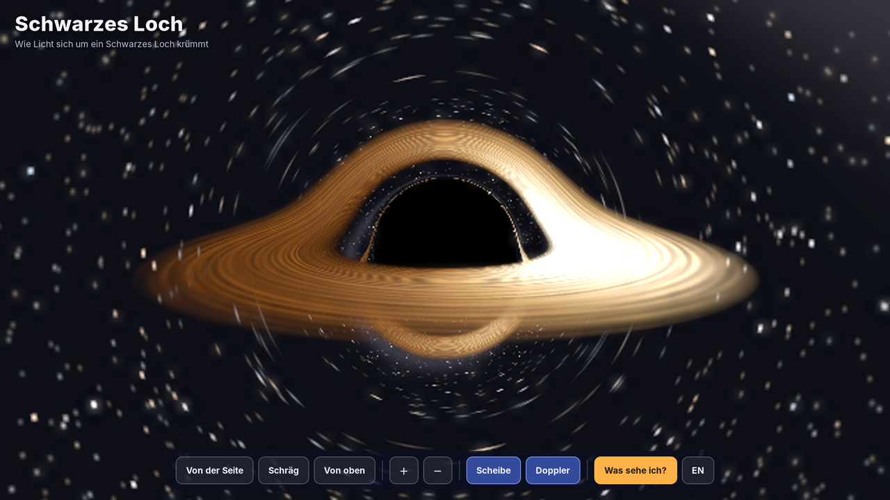

# Schwarzes Loch - Mathematik interaktiv

Interaktive Visualisierung eines Schwarzen Lochs mit Akkretionsscheibe. Für jeden Bildpunkt wird die Lichtbahn im Schwarzschild-Raum berechnet: Schatten, gelinste Rückseite der Scheibe, Einstein-Ring, Doppler-Effekt und gravitative Rotverschiebung.

Umgesetzt nach einem Besuchervorschlag aus der Feedback-Abstimmung am Galadriel-Kiosk
(Mathematisches Institut, Universität Freiburg).

## Screenshot


## Funktionen
- Ziehen mit dem Finger: drehen und neigen; Ansichten „Von der Seite“, „Schräg“, „Von oben“; Zoom
- Akkretionsscheibe und Doppler-Effekt einzeln abschaltbar (ohne Scheibe: Einstein-Ring der Sterne)
- Erklärung „Was sehe ich?“ auf Deutsch und Englisch

## Mathematische Konzepte
- Binet-Gleichung der Allgemeinen Relativitätstheorie für Lichtstrahlen: u″(φ) + u = 3u² (u = 1/r, G = c = M = 1)
- Numerische Lösung mit dem klassischen Runge-Kutta-Verfahren 4. Ordnung für über 200 000 Strahlen
- Dünne Akkretionsscheibe: T ∝ r^(-3/4)(1 − √(r_in/r))^(1/4), Doppler- und Gravitations-Rotverschiebung g = √(1−3/r)/(1 − β cos θ)

## Projektstruktur

- `index.html`: komplette Anwendung (HTML, CSS, JavaScript in einer Datei, keine externen Ressourcen).
- `show.py`: Python-GTK3/WebKit2-Wrapper für die Vollbildanzeige (X, ESC oder Q schließt).
- `start-blackhole`: Startskript für den Galadriel-Kiosk.

Reines Canvas-2D ohne WebGL – läuft auch in WebKitGTK ohne beschleunigtes Compositing (`WEBKIT_DISABLE_COMPOSITING_MODE=1`).

## Starten der Anwendung

### Standalone (lokaler Browser)
`index.html` in einem modernen Webbrowser öffnen.

### Standalone (Vollbild-Fenster)
```bash
python3 show.py
```
Benötigt `python3-gi` und `gir1.2-webkit2-4.1` (Ubuntu 24.04).

### Über Galadriel (Kiosk-Modus)
Als Submodul `blackhole/` im Galadriel-Repository, Start über `./start black-hole` bzw.:
```bash
./start-blackhole
```
